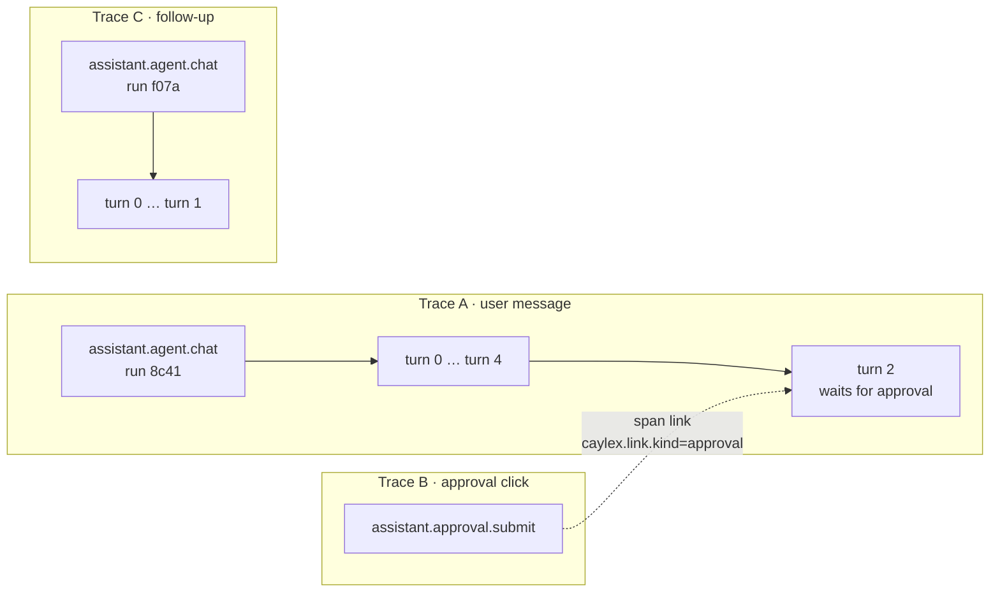

When you forward Caylex Assistants telemetry to your own backend with a [telemetry destination](/administration/telemetry-destinations), one conversation arrives as several traces plus, if you enabled [run content](/administration/telemetry-destinations#run-content), a set of log records. This recipe shows how they fit together, using one realistic conversation, and how to join them to answer questions like:

- What did the user ask, and what did the assistant answer?
- Which tool call failed, with what arguments, and what did the assistant do next?
- How long did the user take to approve, and which turn was waiting?
- Did two runs that behaved differently get the same prompt, tools, and skills?

Everything here comes from the data your destination receives. You don't need the Caylex API.

## The ids that tie it together

| Id | Where | What it groups |
| --- | --- | --- |
| `trace_id` | Every span and run content record | One request: a chat message, an approval click, or one pass of a background task. |
| `caylex.session.id` | Spans and run content records | One conversation (chat session). It stays the same across every message, approval, and background pass in that conversation. |
| `assistant.run.id` | Spans and run content records | One assistant run: the work done for one user message, including any approval wait and sub-assistants. |
| `assistant.turn.index` | Turn, model, and tool spans, and run content records | One loop iteration in a run: a model call plus the tools it asked for. Starts at `0`. |
| `gen_ai.tool.call.id` | Tool spans and tool content records | One tool call. |
| Span links with `caylex.link.kind` | Approval clicks and background task passes | A pointer from a span in one trace to the span in another trace it continues. |
| `span_id` on log records | Run content records | The span a record belongs to. |

The short version: **filter by `caylex.session.id` to get a whole conversation, by `assistant.run.id` to get one answer, and by `trace_id` plus `span_id` to place each log record under its span.**

## Example: "Move the Acme renewal to Closed Won"

A user on your CRM assistant sends a message, approves a write, then sends a follow-up. Run content is on for all seven types. Your destination receives three traces:



All three traces carry the same `caylex.session.id`. Traces A and C are separate runs, so they have different `assistant.run.id` values.

### Trace A: the first message

The span tree, with the attributes that matter most (timings rounded):

```text
assistant.agent.chat                       9.2 s   assistant.run.id=8c41…  caylex.session.id=5b2e…
│                                                  assistant.turns.count=5  assistant.tool_calls.failed=1
│                                                  assistant.time.model_ms=4300  assistant.time.tool_ms=1950
│                                                  assistant.time.approval_wait_ms=2400
│                                                  caylex.prompt.sha256=9e41…  caylex.tools.sha256=3b8d…  caylex.tools.count=38
│                                                  caylex.skills.loaded=["crm-hygiene@4a1f09c2e7b3"]
├─ assistant.turn            #0           1.9 s   assistant.turn.stop_reason=tool_calls
│  ├─ assistant.llm.chat_stream           1.4 s   gen_ai.usage.input_tokens=6120  gen_ai.usage.reasoning_tokens=240
│  ├─ assistant.tool.execute  update_task_list
│  └─ assistant.tool.execute  invoke_tools        gen_ai.tool.call.id=call_02  assistant.tool.result.items=1
├─ assistant.turn            #1           1.7 s   assistant.turn.tool_calls.failed=1
│  ├─ assistant.llm.chat_stream
│  └─ assistant.tool.execute  invoke_tools  ✗    gen_ai.tool.call.id=call_03  status=ERROR
├─ assistant.turn            #2           3.8 s   assistant.turn.approval_wait_ms=2400
│  ├─ assistant.llm.chat_stream
│  ├─ assistant.phase.approval_wait       2.4 s   assistant.approval.outcome=approved
│  │                                              assistant.approval.tool.names=["update_deal"]
│  └─ assistant.tool.execute  invoke_tools        assistant.tool.approval=approved
├─ assistant.turn            #3           0.9 s
│  ├─ assistant.llm.chat_stream
│  └─ assistant.tool.execute  invoke_tools
└─ assistant.turn            #4           0.9 s   assistant.turn.stop_reason=final
   └─ assistant.llm.chat_stream
```

A few things to notice:

- **The run span is the top of the trace.** The HTTP request span above it isn't forwarded, so some tools show `assistant.agent.chat` as having a missing parent. That's expected.
- **Totals live on the run span.** `assistant.turns.count`, the time split between the model, tools, and waiting on the user, and the failed tool call count let you sort or alert on runs without opening them.
- **The fingerprint lives on the run span too.** `caylex.prompt.sha256` and `caylex.tools.sha256` are hashes of the system prompt and the tool definitions. `caylex.skills.loaded` lists each skill the run read, as `slug@` plus a hash of its text. Two runs with the same values saw the same instructions.
- **Tool calls go through the Navigator.** Calls to your connected servers appear as `invoke_tools`. Which tools it ran, and with what inputs, is in its tool arguments record (below). Planning calls like `update_task_list` are separate tool spans.
- **Failed calls are marked.** Turn 1's call failed: its span has status `ERROR`, an `error.type`, and a status message with the error text (secrets masked). The turn and the run count it in `tool_calls.failed`.

### The run content records in trace A

Each record is an OTel log record with the `trace_id` of trace A and the `span_id` of the span it belongs to. Every record also carries `caylex.session.id`, `assistant.run.id`, `assistant.turn.index` (once a turn has started), and `caylex.content.class`. The record's event name says what it is.

In the order they happen:

<AccordionGroup>
  <Accordion title="User message (on the run span)">
    ```json
    {
      "event_name": "caylex.assistant.message.user",
      "attributes": {
        "caylex.content.class": "user_messages",
        "caylex.message.kind": "user",
        "caylex.session.id": "5b2e…",
        "assistant.run.id": "8c41…"
      },
      "body": { "text": "Move the Acme renewal to Closed Won" }
    }
    ```
    `caylex.message.kind` tells you where the text came from: `user` (a chat message), `background_prompt` (a background task's instructions), `continuation` (a follow-up sent to a running background task), `context_update` (context your app pushed into the conversation), `subassistant_prompt`, or `voice`. Attachments appear in `body.attachments` as `{id, filename, size_bytes, sha256}`, without their contents.
  </Accordion>
  <Accordion title="Reasoning and interim reply (on turn 0)">
    ```json
    {
      "event_name": "caylex.assistant.reasoning",
      "attributes": {
        "caylex.content.class": "reasoning",
        "caylex.reasoning.kind": "text",
        "gen_ai.response.model": "anthropic/claude-sonnet-5.5",
        "assistant.turn.index": 0
      },
      "body": { "text": "Need the deal id. Search for the Acme renewal, then update the stage. That's a write, so it needs approval." }
    }
    ```
    ```json
    {
      "event_name": "caylex.assistant.message.assistant",
      "attributes": {
        "caylex.content.class": "assistant_messages",
        "caylex.message.final": false,
        "assistant.turn.index": 0
      },
      "body": { "text": "Let me find the Acme renewal first." }
    }
    ```
    `caylex.reasoning.kind` is `text` or `summary`, depending on what the model provider returns. `caylex.message.final` is `false` for text the assistant writes before calling tools, and `true` for its answer.
  </Accordion>
  <Accordion title="Task list (on the update_task_list tool span)">
    ```json
    {
      "event_name": "caylex.assistant.task_list",
      "attributes": {
        "caylex.content.class": "task_list",
        "assistant.tool.name": "update_task_list",
        "gen_ai.tool.call.id": "call_01"
      },
      "body": {
        "todos": "[{\"content\": \"Find the Acme renewal\", \"id\": \"1\", \"status\": \"in_progress\"}, {\"content\": \"Set stage to Closed Won\", \"id\": \"2\", \"status\": \"pending\"}, {\"content\": \"Verify the update\", \"id\": \"3\", \"status\": \"pending\"}]",
        "merge": "false"
      }
    }
    ```
  </Accordion>
  <Accordion title="Tool arguments and result (on the invoke_tools span)">
    ```json
    {
      "event_name": "caylex.assistant.tool.arguments",
      "attributes": {
        "caylex.content.class": "tool_arguments",
        "assistant.tool.name": "invoke_tools",
        "gen_ai.tool.call.id": "call_02"
      },
      "body": {
        "arguments": "{\"tool_calls\": [{\"intent\": \"Find the Acme renewal deal\", \"tool_name\": \"search_deals\", \"tool_params\": {\"query\": \"Acme renewal\"}}]}"
      }
    }
    ```
    ```json
    {
      "event_name": "caylex.assistant.tool.result",
      "attributes": {
        "caylex.content.class": "tool_results",
        "assistant.tool.name": "invoke_tools",
        "gen_ai.tool.call.id": "call_02",
        "assistant.tool.is_error": false
      },
      "body": {
        "result": "{\"tool_results\": [{\"tool_name\": \"search_deals\", \"result\": {\"deals\": [{\"id\": \"D-4411\", \"name\": \"Acme 2027 renewal\", \"stage\": \"Negotiation\"}, {\"id\": \"D-3920\", \"name\": \"Acme 2026 renewal\", \"stage\": \"Closed Won\"}]}}], \"successful_tools\": 1, \"failed_tools\": 0}"
      }
    }
    ```
    Structured values are sent as JSON strings, so parse `body.arguments` and `body.result` to work with them.
  </Accordion>
  <Accordion title="The failed call (on turn 1's invoke_tools span)">
    ```json
    {
      "event_name": "caylex.assistant.tool.result",
      "attributes": {
        "caylex.content.class": "tool_results",
        "assistant.tool.name": "invoke_tools",
        "gen_ai.tool.call.id": "call_03",
        "assistant.tool.is_error": true
      },
      "body": { "error": "Error executing tool: 404: no deal with id '4411'. Deal ids are prefixed, e.g. 'D-4411'." }
    }
    ```
    Next to the turn 2 reasoning record ("I dropped the D- prefix…"), this is the full story of the failure and the recovery.
  </Accordion>
  <Accordion title="Approval (on assistant.phase.approval_wait)">
    ```json
    {
      "event_name": "caylex.assistant.approval",
      "attributes": {
        "caylex.content.class": "approvals",
        "assistant.approval.outcome": "approved",
        "gen_ai.tool.call.id": "call_04"
      },
      "body": {
        "items": "[{\"approval_id\": \"apv_1\", \"tool_name\": \"update_deal\", \"server_name\": \"crm\", \"intent\": \"Set the Acme 2027 renewal to Closed Won\", \"tool_params\": {\"deal_id\": \"D-4411\", \"stage\": \"Closed Won\"}, \"decision\": \"approved\"}]"
      }
    }
    ```
  </Accordion>
  <Accordion title="Final answer (on turn 4)">
    ```json
    {
      "event_name": "caylex.assistant.message.assistant",
      "attributes": {
        "caylex.content.class": "assistant_messages",
        "caylex.message.final": true,
        "assistant.turn.index": 4
      },
      "body": { "text": "Done. The Acme 2027 renewal (D-4411) is now Closed Won. I left the 2026 renewal alone since it was already closed." }
    }
    ```
  </Accordion>
</AccordionGroup>

If a value is longer than the destination's size limit, it's cut to the limit and the record gets `caylex.content.truncated=true`, `caylex.content.original_bytes`, and `body._truncated.<field>` with the field's full size and SHA-256.

### Trace B: the approval click

When the user clicks **Approve**, that request is its own trace:

```text
assistant.approval.submit     0.2 s   assistant.approval.batch.id=apr_19d3…  assistant.run.id=8c41…
  └─ link → trace A, assistant.turn #2   caylex.link.kind=approval
```

The span link points at the turn that was waiting, so tools that render links (Honeycomb, Jaeger, Tempo, and others) take you from the click to the wait. The click span carries the same `assistant.run.id` as the run it approved. The same decision also appears inside trace A as the `assistant.phase.approval_wait` span and the approval record above, so you can follow approvals from either side.

<Note>
The click span is tagged with the approver's workspace and, when the approval comes through a project-scoped widget, the project. If a destination is limited to specific projects and an approval arrives without a project, that destination doesn't receive the click span. Trace A still has the full approval.
</Note>

### Trace C: the follow-up

The follow-up message ("Add a note that legal signed off") is a new run in the same conversation:

```text
assistant.agent.chat                3.5 s   assistant.run.id=f07a…  caylex.session.id=5b2e…
├─ assistant.turn #0                        assistant.turn.stop_reason=tool_calls
│  ├─ assistant.llm.chat_stream
│  └─ assistant.tool.execute  invoke_tools
└─ assistant.turn #1                        assistant.turn.stop_reason=final
   └─ assistant.llm.chat_stream
```

New `trace_id`, new `assistant.run.id`, same `caylex.session.id`. Turn numbering starts again at `0`.

## Background tasks

[Agent tasks](/background-tasks/agent-tasks) run in the background, so they add two kinds of span links:

- **Enqueue.** Each pass of a task is an `assistant.worker.task.process` trace with a link (`caylex.link.kind=enqueue`) back to the request that created the task.
- **Resume.** When a task pauses for approval or review and later continues, the new pass links (`caylex.link.kind=resume`) to the span where it paused.

Every pass of a task shares one `assistant.run.id` (the task's id) and the task's `caylex.session.id`, so filtering by either one gathers all of its passes. Its instructions arrive as a user message record with `caylex.message.kind=background_prompt`.

## Sub-assistants

When an assistant hands work to a sub-assistant, the sub-assistant's run is an `assistant.agent.subassistant` span inside the parent's `invoke_subassistant` tool span, in the same trace and with the same `assistant.run.id`. It has its own turns and its own totals and fingerprint. Its reasoning and messages carry `assistant.subassistant=true`, so you can show or hide them.

## Recipes

### Rebuild the conversation

Collect the run content records for one `caylex.session.id` and order them by timestamp. This Python function works on log records exported from most backends, as long as each record has its timestamp, attributes, and body:

```python
import json

def transcript(records):
    """Print a readable conversation from Caylex run content records."""
    for rec in sorted(records, key=lambda r: r["timestamp"]):
        attrs, body = rec["attributes"], rec["body"]
        kind = attrs.get("caylex.content.class")
        sub = "  (sub-assistant)" if attrs.get("assistant.subassistant") else ""
        if kind == "user_messages":
            print(f"User{sub}: {body.get('text', '')}")
        elif kind == "assistant_messages":
            label = "Assistant" if attrs.get("caylex.message.final") else "Assistant (interim)"
            print(f"{label}{sub}: {body.get('text', '')}")
        elif kind == "reasoning":
            print(f"  thinking{sub}: {body.get('text', '')}")
        elif kind == "tool_arguments":
            args = json.loads(body.get("arguments") or "{}")
            for call in args.get("tool_calls", [args]):
                print(f"  → {call.get('tool_name', attrs.get('assistant.tool.name'))} {call.get('tool_params', call)}")
        elif kind == "tool_results":
            mark = "✗" if attrs.get("assistant.tool.is_error") else "←"
            print(f"  {mark} {body.get('error') or body.get('result', '')}")
        elif kind == "approvals":
            for item in json.loads(body.get("items") or "[]"):
                print(f"  approval: {item['tool_name']} {item['decision']}")
```

For the example above, it prints:

```text
User: Move the Acme renewal to Closed Won
  thinking: Need the deal id. Search for the Acme renewal, then update the stage. That's a write, so it needs approval.
Assistant (interim): Let me find the Acme renewal first.
  → search_deals {'query': 'Acme renewal'}
  ← {"tool_results": [{"tool_name": "search_deals", ...}], "successful_tools": 1, "failed_tools": 0}
  → get_deal {'deal_id': '4411'}
  ✗ Error executing tool: 404: no deal with id '4411'. Deal ids are prefixed, e.g. 'D-4411'.
  thinking: I dropped the D- prefix. The search already had what I need.
  approval: update_deal approved
  ...
Assistant: Done. The Acme 2027 renewal (D-4411) is now Closed Won. ...
User: Add a note that legal signed off
...
```

### Find failing tool calls, with their inputs

1. Find `assistant.tool.execute` spans with status `ERROR`, or `assistant.agent.chat` spans with `assistant.tool_calls.failed > 0`.
2. For each failing tool span, look up the `tool_arguments` and `tool_results` records with the same `trace_id` and `gen_ai.tool.call.id`.
3. To see how the assistant reacted, read the `reasoning` record for the next `assistant.turn.index` in the same `assistant.run.id`.

<Tip>
`invoke_tools` can run several of your server's tools in one call. A failure of the whole call marks the span `ERROR`. When only some of the tools in the batch fail, the span succeeds and the result record shows which ones failed, in `tool_results[].error` and `failed_tools`.
</Tip>

### Compare runs that behaved differently

Group `assistant.agent.chat` spans by `caylex.prompt.sha256`, `caylex.tools.sha256`, and `caylex.skills.loaded`. If two runs share all three, they got the same instructions, tools, and skill text, so look at the conversation or the tool results for the difference. If a hash changed, the prompt, a tool definition, or a skill changed between them.

### Measure how long users take to approve

Use `assistant.time.approval_wait_ms` on run spans for the total per run, `assistant.turn.approval_wait_ms` for the turn that waited, or the duration of the `assistant.phase.approval_wait` span. `assistant.approval.outcome` tells you whether the user approved (`approved`, `rejected`, `partial`, or `timed_out`).

## Reference: span names

| Span | What it is |
| --- | --- |
| `assistant.agent.chat` | One assistant run for a user message. `assistant.agent.resume` when a streaming run picks up after an interruption, `assistant.agent.subassistant` for a sub-assistant. |
| `assistant.turn` | One loop iteration. `assistant.turn.stop_reason` is `tool_calls`, `final`, `approval_required`, `output_token_limit`, `no_response`, or `error`. |
| `assistant.llm.chat_stream`, `assistant.llm.chat` | One model call, with `gen_ai.request.model`, `gen_ai.response.model`, and `gen_ai.usage.*` token counts. |
| `assistant.tool.execute` | One tool call, with `assistant.tool.name`, `gen_ai.tool.call.id`, and the result's size (`assistant.tool.result.bytes`, plus `items` and `has_more` for JSON results). |
| `assistant.tool.batch` | The tool calls of one turn run together. |
| `assistant.phase.approval_wait` | The time spent waiting for a user's approval. |
| `assistant.approval.submit` | A user's approval click, linked to the waiting turn. |
| `assistant.worker.task.process` | One pass of a background task, linked to what started or resumed it. |
| `assistant.phase.*` | Other stages of a streaming run, such as `mcp_connect`, `list_tools`, `load_transcript`, `context_prep`, and `llm_ttft` (time to first token). |
