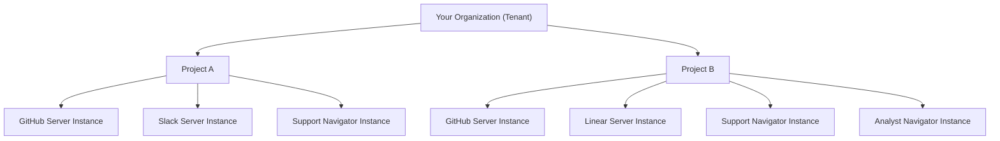

Caylex organizes your navigators, servers, and permissions into a few key concepts. Understanding these concepts is essential for setting up your deployment.

## Projects

A **Project** represents a deployment for a specific customer, team, or environment. Think of each project as:

- A deployment for a specific customer
- A deployment for a specific team in your company
- A separate environment (staging, production)

Each project contains:

- **Server Instances** — which MCP servers are connected
- **Navigator Instances** — which navigators are deployed
- **User Auth Credentials** — authentication credentials used to connect with external services on behalf of users

Projects provide **complete isolation** — each one has independent configurations, credentials, and permissions.

## Servers and Server Instances

### Server

A **Server** is a reusable definition of an MCP server. It defines:

- The endpoint URL and transport type (Streamable HTTP or SSE)
- The authentication method (OAuth, Header, Path, Query, or No Auth)
- The tools that the server exposes

Servers can come from the **Caylex Catalog** (pre-configured servers like GitHub, Slack, Linear, and Notion) or be added as **custom servers** that you manage.

### Server Instance

A **Server Instance** is a Server connected to a specific Project. It:

- Links a Server to your Project
- Has project-specific authentication credentials
- Can be paused or activated independently per project
- Allows the same Server to be used across multiple Projects with different configurations

<Info>
**Example:** You connect the GitHub MCP to your "Customer A" project with one set of credentials and to your "Customer B" project with different credentials. That creates two Server Instances of the same Server.
</Info>

## Navigators and Navigator Instances

### Navigator Identity

A **Navigator Identity** is the definition or template of a navigator. It defines the navigator's name and purpose. Examples: "Customer Support Navigator", "Data Analyst Navigator", "Code Review Navigator".

### Navigator Instance

A **Navigator Instance** is a Navigator Identity deployed in a specific Project. It:

- Links a Navigator Identity to a Project
- Has its own **API key** for authentication
- Can have **tool restrictions** (block specific tools for this deployment)
- Can have **server restrictions** (block entire servers for this deployment)
- Allows the same navigator to be deployed across multiple Projects with different permissions

<Info>
**Example:** You deploy your "Support Navigator" to "Customer A" with full tool access and to "Customer B" with restricted access to sensitive tools. That creates two Navigator Instances of the same Navigator Identity.
</Info>

### Navigator kinds

Every navigator has a kind, chosen when you create it and fixed afterwards. The kind decides who the navigator serves and what it exposes by default.

- **Standard navigator**: the navigator your own agents connect to, from your backend, an agent framework or the [Agent Widget](/widget/overview). It exposes the project's tools and skills, and you restrict what it shouldn't use.
- **Public connector**: a navigator you publish to your users, who add it to their own AI client (such as Claude Desktop) as an MCP server. It exposes nothing until you enable it, and offers [agent tasks](/public-connectors/agent-tasks): named jobs that run a Caylex agent on a standard navigator in the same project, as the calling user.

| | Standard navigator | Public connector |
| --- | --- | --- |
| Who connects | Your agents and the Agent Widget | Your users' AI clients |
| Tools and skills | On by default, restricted as a deny list | Off by default, enabled one by one |
| Adaptive Tool Search, Code Mode, Context Maps | Available | Not available |
| Agent tasks | No | Yes, running on standard navigators |

Both kinds use the same Navigator Identity and Instance model, the same API keys and the same `x-api-key` and `x-user-email` headers. A public connector usually sits next to one or more standard navigators in a project: the standard navigators do the work, and the connector decides which of it your users can reach.

<Card title="Public Connectors" icon="globe" href="/public-connectors/overview">
  When to publish a connector, and how to set one up.
</Card>

## How they work together

When your agent connects to Caylex, two pieces of information identify the context:

1. **API Key** (`x-api-key` header) — identifies the Navigator Instance, which tells Caylex which Project the request belongs to
2. **User Email** (`x-user-email` header) — identifies the end user interacting with the agent

This gives Caylex the context needed to:

- Show only the tools available to that navigator in that project
- Apply the navigator's tool and server permissions, which depend on its [kind](#navigator-kinds)
- Use the right authentication credentials for each MCP server (based on the user's email for user-level auth)
- Track usage and provide per-user analytics

<Tip>
This architecture gives you enterprise-grade multi-tenancy with fine-grained access control. Each project is fully isolated, so you can safely deploy the same navigators and servers across different customers or teams.
</Tip>

## What's next

<CardGroup cols={2}>
  <Card title="Create a Project" icon="folder" href="/platform/projects">
    Set up your first project and configure it.
  </Card>
  <Card title="Add Servers" icon="server" href="/platform/servers">
    Connect servers from the catalog or add your own.
  </Card>
  <Card title="Configure Navigators" icon="compass" href="/platform/navigators">
    Create navigators and set up tool permissions.
  </Card>
  <Card title="Connect Your Agent" icon="plug" href="/integration/connecting">
    Integrate Caylex with your agent framework.
  </Card>
</CardGroup>
