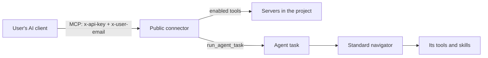

A **public connector** is a navigator you publish to your users. Each user adds it to their own AI client, such as Claude Desktop or Claude.ai, as one MCP server. What the connector offers is exactly what you choose:

- **Agent tasks**: named jobs the user's AI can hand off. Each one runs a full Caylex agent on a standard navigator in the same project, with that navigator's tools and skills, and returns a written report.
- **Tools and skills** you enable on the connector itself, which the user's AI calls directly.

Nothing else from the project is exposed. A new connector offers no tools and no skills until you enable them.

## How it works



1. The user's AI connects to the Caylex Navigator with the connector's API key and the user's email, like any [navigator connection](/integration/connecting).
2. The connector tells the AI to start with its list tool, which returns the agent tasks and tools on offer.
3. The AI calls enabled tools directly, or starts an agent task with `run_agent_task`.
4. An agent task runs as a [background agent task](/background-tasks/agent-tasks) on its standard navigator, **as the calling user**, with that user's own sign-ins. The AI gets back the report, or the actions waiting for the user's approval.

## How it differs from a standard navigator

A public connector is one of the two [navigator kinds](/core-concepts#navigator-kinds); Core Concepts compares them side by side. What matters when you set one up:

- Its tools and skills start off, including skills added to the project later. You enable each one.
- Adaptive Tool Search, Code Mode and Context Maps aren't available.
- Its agent tasks run on standard navigators in the same project, so a connector needs at least one standard navigator next to it to do more than call tools directly.
- The kind is chosen when you create the navigator and can't be changed later.

## Create a public connector

<Steps>
  <Step title="Start a new navigator">
    In the Caylex dashboard, open **Navigator Library** from the sidebar and click **New Navigator**.
  </Step>
  <Step title="Fill in the details">
    On the **Details** step, enter a **Navigator Name** and a **Description**, then turn on **Public Connector** ("Publish this navigator to your users as a connector").

    The name also sets the connector's list tool name. For example, a connector named "Acme Support" offers `acme_support_list_tools`.
  </Step>
  <Step title="Connect it to projects">
    On the **Connections** step, pick one or more **Enabled Projects** and click **Next**. Each project gets a navigator instance of the connector, with its own API key, permissions and agent tasks.
  </Step>
</Steps>

<Accordion title="Using the REST API">
  Create the navigator with `kind: "connector"`, then connect it to projects. Both calls use the [Platform API](/cookbooks/overview) base URL and a platform access token.

  ```bash
  curl -X POST https://api.caylex.ai/api/v1/navigators \
    -H "Authorization: Bearer $CAYLEX_PLATFORM_TOKEN" \
    -H "Content-Type: application/json" \
    -d '{"name": "Acme Support", "description": "Support tasks for Acme customers", "kind": "connector"}'

  curl -X POST https://api.caylex.ai/api/v1/navigators/{navigator_id}/connections \
    -H "Authorization: Bearer $CAYLEX_PLATFORM_TOKEN" \
    -H "Content-Type: application/json" \
    -d '{"project_ids": ["{project_id}"]}'
  ```

  `kind` is `standard` (the default) or `connector`. The connections call replaces the navigator's whole set of projects.
</Accordion>

## Give users an API key

Connector API keys work exactly like other navigator keys: open the connector's instance, go to the **API Keys** tab and click **Create API Key**. See [Generate an API key](/platform/navigators#generate-an-api-key), or [Generate Navigator API Keys](/cookbooks/generate-navigator-api-keys) to mint keys from your backend.

Your users put the key in the `x-api-key` header and their own email in `x-user-email`. The email decides whose sign-ins the connector's tools and agent tasks use. See [Calling a Public Connector](/public-connectors/mcp-tools) for a client setup example.

## Choose what the connector offers

Open the connector's instance from the project's **Navigators** tab. For a connector, the drawer shows **Agent Tasks**, **Tool Permissions**, **Skill Permissions** and **API Keys**.

- **Agent Tasks**: add the jobs users can run. See [Connector Agent Tasks](/public-connectors/agent-tasks).
- **Tool Permissions**: turn on the tools the user's AI may call directly. Per-server **Enable All** turns on a whole server.
- **Skill Permissions**: show the skills the user's AI may discover and load.

<Info>
On a connector, a tool with no permission set is **off**. This is the reverse of a standard navigator, where tools are on unless you turn them off. Permission responses from the API mark these tools with the reason `connector-default`.
</Info>

Adaptive Tool Search, Code Mode and Context Maps can't be turned on for a connector. The API answers `400` with "&lt;capability&gt; is not available on public connectors".

## Use a connector in the Agent Widget

A connector API key also works in the [Agent Widget](/widget/agent/embed). The widget's **Connected Apps** lists the servers the connector reaches: servers with tools enabled on the connector, plus the servers its enabled agent tasks use on their navigators. Users can sign in to all of them from there.

The widget's Background Tasks inbox lists the user's agent task runs from this connector. Whether it also shows each run's transcript follows the task's **Show transcript in chat widget** setting.

## Remove a connector or its target navigators

Agent task runs use credentials tied to their task, so Caylex won't remove them mid-run:

- Disconnecting a connector from a project, or deleting it, returns `409` while any of its agent tasks has runs in progress. Disable those tasks, wait for the runs to finish, then try again.
- A standard navigator that agent tasks run on can't be disconnected from that project or deleted. The API returns `409` naming the tasks: "This navigator runs public connector agent tasks (…); delete or retarget them first".

## Next steps

<CardGroup cols={2}>
  <Card title="Connector Agent Tasks" icon="robot" href="/public-connectors/agent-tasks">
    Add the jobs your users can run, in the dashboard or through the API.
  </Card>
  <Card title="Calling a Public Connector" icon="plug" href="/public-connectors/mcp-tools">
    The MCP tools a connector offers and how a user's AI uses them.
  </Card>
</CardGroup>
