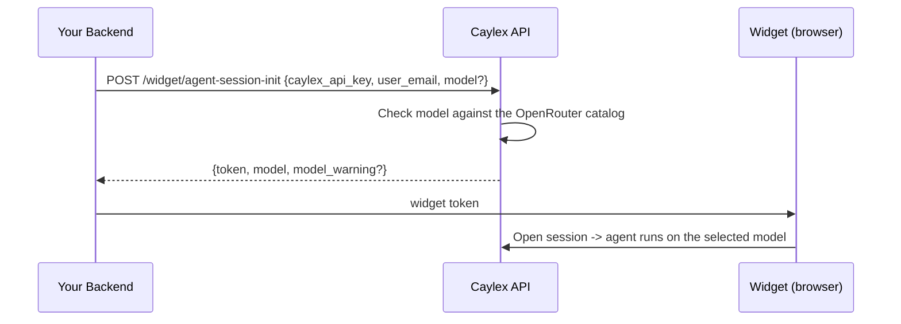

The Caylex agent runs on its default model. **Model selection** lets your backend override that on a per-session basis by passing an optional `model` when it starts an agent session, so you can match the model to the use case (for example, a faster, cheaper model for lightweight chat, or a larger model for complex work).

## Overview

The model is chosen server-side, at the same place you already start a session: the `POST /widget/agent-session-init` call. Caylex checks the requested model against [OpenRouter's model catalog](#available-models), signs it into the short-lived widget token, and the agent uses it for the turns the widget sends with that token.

<Note>
The model is selected by **your backend** when it mints the session token. The widget package (browser) does not choose the model, and there is no widget prop for it. This keeps model choice under your control and out of the browser.
</Note>

Each token is minted for one `user_email`, so you can give different users different models, for example a larger model for users on a premium plan.

## How It Works



The selected model is recorded on the chat session, along with the model's context window and output limit, and later turns reuse them until the model changes.

Send the same `model` every time you mint a token for a user, including the call your backend makes when the widget's `refreshToken` callback asks for a new token, unless you want the session to switch models.

### Changing the Model Mid-Session

Each turn runs on the model in the token the widget sends with it. When the widget picks up a token minted for a different `model`, the session's next turn switches to that model and the conversation carries on. A turn that's already running finishes on the model it started with.

- If a later token has no `model`, a session on a model you chose goes back to the agent's default model.
- If the later token's `model` was ignored (the response had a `model_warning`), the session keeps the model it's on.
- Switching to a model with a smaller context window can compact the conversation on the next turn. Caylex summarizes older turns to fit, and in very long sessions the oldest detail can be dropped from the summary.
- Reasoning a model saved during earlier tool calls is only sent back to that model, never to the one you switch to.
- [Agent tasks](/background-tasks/agent-tasks) and [background sync](/background-tasks/background-sync) runs keep the model they started with.

When a session runs on a model you chose, any subassistants its agent delegates work to run on that model too. When you don't pass `model`, each subassistant keeps its own default model.

## Request

Add an optional `model` to the session-init body:

```json
{
  "caylex_api_key": "ck_your_navigator_api_key",
  "user_email": "jane@example.com",
  "model": "anthropic/claude-opus-4.8"
}
```

| Field | Required | Description |
| --- | --- | --- |
| `model` | No | OpenRouter model id (`provider/model`) from [`GET /agent-models`](#available-models). Omit to use the Caylex agent's default model. Unsupported values are ignored (the agent keeps its default model) and return a `model_warning`. |

## Response

```json
{
  "token": "eyJhbGciOiJIUzI1NiIsInR5cCI6IkpXVCJ9...",
  "expires_at": "2026-06-16T15:30:00+00:00",
  "model": "anthropic/claude-opus-4.8",
  "model_warning": null
}
```

| Field | Description |
| --- | --- |
| `model` | The model selected for the session, or `null` when no override applies — either no `model` was requested, or the requested model was unsupported and ignored. In both cases a new session uses the agent's default model. For a session that's already running, see [Changing the Model Mid-Session](#changing-the-model-mid-session). |
| `model_warning` | `null` on success. Set to a message when the requested model was ignored: it says why and points to `GET /agent-models` and this page. |

## Available Models

Caylex reads the model list from [OpenRouter's catalog](https://openrouter.ai/models) instead of keeping its own. Any OpenRouter model can be picked when OpenRouter reports that it:

- takes text in and gives text out;
- supports tool calling;
- has a context window of at least **256,000 tokens**;
- allows at least **16,000 completion tokens** per response;
- publishes its context window, output limit and pricing.

`:free` variants are excluded.

<Info>
Models with a context window of **1M tokens or more** are marked `recommended`, since long agent sessions with many tool results fit in them without compaction.
</Info>

`GET /agent-models` returns the models you can pick right now, recommended first. Authenticate it with your platform access token, like the session-init call:

```
GET https://api.caylex.ai/api/v1/agent-models
```

```json
{
  "models": [
    {
      "id": "anthropic/claude-sonnet-4.6",
      "label": "Anthropic: Claude Sonnet 4.6",
      "context_window": 1000000,
      "max_output_tokens": 128000,
      "recommended": true,
      "pricing": {
        "input_usd_per_1m": 4.5,
        "output_usd_per_1m": 22.5,
        "priced_at_fallback": false
      }
    },
    {
      "id": "openai/gpt-5.4-mini",
      "label": "OpenAI: GPT-5.4 Mini",
      "context_window": 400000,
      "max_output_tokens": 128000,
      "recommended": false,
      "pricing": {
        "input_usd_per_1m": 1.125,
        "output_usd_per_1m": 6.75,
        "priced_at_fallback": false
      }
    }
  ]
}
```

| Field | Description |
| --- | --- |
| `id` | OpenRouter model id. Pass it as `model`. |
| `label` | OpenRouter's display name. |
| `context_window` | Context window in tokens. |
| `max_output_tokens` | Maximum completion tokens per response. |
| `recommended` | `true` for models with a context window of 1M tokens or more. |
| `pricing` | What your organization is billed per million input and output tokens on this model. `priced_at_fallback` is `true` when Caylex has no rate for the model yet, so the default rate applies. `null` when pricing isn't configured. |

The list follows OpenRouter: new models appear when OpenRouter lists them, and models OpenRouter retires or changes so they no longer qualify drop out. Read the list when you build a picker rather than hard-coding ids.

If `model` is omitted, the session uses the **Caylex agent's default model**, falling back to the platform default **`anthropic/claude-sonnet-4.6`** when none is set. Passing `model` only overrides that for the session when you explicitly request a model from the list.

### Choosing a Model

Every model on the list can run the Caylex agent, but they don't all run it equally well. Smaller models can miss steps, call tools less reliably or give weaker answers, and larger ones cost more per token. You're responsible for the quality and the cost of the model you pick: test it on your own tasks before you roll it out, and check its `pricing` against your expected usage.

## Fallback Behavior

Model selection never fails the session for an unsupported model. If you pass a model that isn't on the list:

- The requested model is **ignored** — it does not override the agent's default model.
- The session is created using the agent's default model (the same as if no `model` were passed).
- The response `model` is `null` and `model_warning` explains why.

This makes it safe to pass a model id without pre-validating it: a typo never silently downgrades the agent's default model, and the warning surfaces the problem to your backend.

### When OpenRouter's Catalog Is Unavailable

Caylex caches the catalog and refreshes it every hour, so a short OpenRouter outage usually goes unnoticed. If the catalog can't be read and nothing is cached, Caylex can't check a new model, so it doesn't accept one:

- `POST /widget/agent-session-init` and `POST /agent-task` ignore the requested model and return a `model_warning` saying the catalog is unavailable. The session or task runs on the agent's default model.
- Saving a sync config with a new `model` returns `503`. Try again shortly.
- `GET /agent-models` returns `503`.

Choices Caylex already accepted are kept: a session already on a model you chose (a refreshed token whose model was ignored doesn't move it), a sync config's saved model, and the model saved in a widget design all keep working during an outage.

## Example

Add the optional `model` to your existing backend token call, and use the same call whenever the widget refreshes its token.

<Tabs>
  <Tab title="Python">
    ```python token.py
    import httpx

    CAYLEX_API_URL = "https://api.caylex.ai/api/v1/"
    PLATFORM_TOKEN = "your_platform_access_token"
    CAYLEX_API_KEY = "ck_your_navigator_api_key"

    async def mint_widget_token(user_email: str, model: str | None = None) -> str:
        payload = {
            "caylex_api_key": CAYLEX_API_KEY,
            "user_email": user_email,
        }
        if model:
            # Optional; omit to use the agent's default model.
            payload["model"] = model

        async with httpx.AsyncClient() as client:
            response = await client.post(
                f"{CAYLEX_API_URL}widget/agent-session-init",
                headers={"Authorization": f"Bearer {PLATFORM_TOKEN}"},
                json=payload,
            )
            response.raise_for_status()
            data = response.json()
            if data.get("model_warning"):
                print(data["model_warning"])
            return data["token"]
    ```
  </Tab>

  <Tab title="TypeScript">
    ```typescript token.ts
    const CAYLEX_API_URL = "https://api.caylex.ai/api/v1/";
    const PLATFORM_TOKEN = process.env.CAYLEX_PLATFORM_TOKEN!;
    const CAYLEX_API_KEY = process.env.CAYLEX_NAVIGATOR_API_KEY!;

    export async function mintWidgetToken(
      userEmail: string,
      model?: string,
    ): Promise<string> {
      const response = await fetch(`${CAYLEX_API_URL}widget/agent-session-init`, {
        method: "POST",
        headers: {
          "Authorization": `Bearer ${PLATFORM_TOKEN}`,
          "Content-Type": "application/json",
        },
        body: JSON.stringify({
          caylex_api_key: CAYLEX_API_KEY,
          user_email: userEmail,
          model, // optional; omit to use the agent's default model
        }),
      });

      if (!response.ok) {
        throw new Error("Failed to mint Caylex widget token");
      }

      const data = await response.json();
      if (data.model_warning) {
        console.warn(data.model_warning);
      }
      return data.token;
    }
    ```
  </Tab>
</Tabs>

To choose per user, decide the model in the route your frontend calls for tokens. The widget calls the same route for its first token and from `refreshToken`, so every token for a user carries the same model:

```typescript
app.get("/api/caylex/token", requireAuth, async (req, res) => {
  // Omit model to use the agent's default model.
  const model = req.user.plan === "premium" ? "anthropic/claude-opus-4.8" : undefined;
  res.json({ token: await mintWidgetToken(req.user.email, model) });
});
```

The frontend integration is unchanged — pass the returned `token` to the widget as described in [Embed The Chat Widget](/widget/agent/embed).

## Widget Design Space

The chat widget's design space in the Caylex app has a **Model** picker. Its preview sessions run on the model you pick, the generated backend snippet includes it as `model` in the `POST /widget/agent-session-init` body, and saved designs remember it.

## Background Tasks and Syncs

The same models work outside the widget:

- **[Background tasks](/background-tasks/agent-tasks)**: pass `model` on `POST /agent-task`. A model that isn't on the list is ignored with a `model_warning`, as it is on session-init.
- **[Background Sync](/background-tasks/background-sync)**: save `model` on the sync config. Every task a trigger starts runs on it. Saving a model that isn't on the list returns `422`. If a saved model later drops off the list, a trigger runs the tasks on the agent's default model and returns a `model_warning`.

In both cases, subassistants follow the chosen model, as they do in widget sessions.
