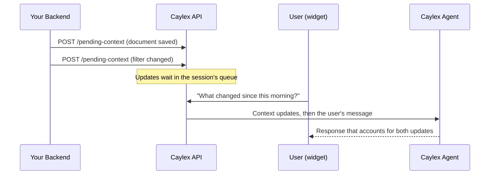

Pending context lets your backend tell the agent what is happening in your application without starting an agent turn. Queue an update whenever something changes, such as a document being saved, a filter being applied, or a record being edited, and Caylex delivers every queued update to the agent the next time the user sends a message.

Use pending context when the agent should be aware of app activity but should only act when the user asks for help. If you need the agent to respond to an event right away, send a [programmatic chat turn](/widget/agent/programmatic-chat-turns) instead.

| | Pending context | Programmatic chat turn |
| --- | --- | --- |
| Runs the agent | No | Yes, synchronously |
| Appears in the transcript | As one collapsed indicator above the next user message | As a user message |
| Typical use | Frequent state changes and app events | Asking the agent to do something now |

## How It Works



Adding an update returns immediately, with no agent run. The queue is delivered at the start of the next agent run that begins from a user message:

- A message typed in the chat widget.
- A [programmatic chat turn](/widget/agent/programmatic-chat-turns), unless it sets `include_pending_context` to `false`.
- A voice request that the voice agent hands off to the Caylex agent.

The queue is not delivered by a voice reply the voice agent answers on its own, by resuming an interrupted run, by an approval decision, or by background tasks. Delivered updates are removed from the queue and saved in the session transcript, so the agent can still refer to them on later turns.

<Warning>
Call the pending-context API from your backend. Platform access tokens and navigator API keys must never be exposed to the browser.
</Warning>

## Keys and Ordering

Each update can include an optional `key`:

- **Without a key**, every update is kept. Use this for events, such as "The user added a section titled Q4 Goals."
- **With a key**, a new update replaces the queued update that has the same key. Use this for the latest state of something, such as the current outline of a document, so the agent only sees the newest version.

You can mix both styles in the same session. Updates are delivered in chronological order of their latest change: when a keyed update is replaced, it moves to the position of its newest version.

Replacing and deleting only affect updates that are still queued. Once a batch has been delivered with a message, it stays in the transcript.

## Endpoints

All endpoints are scoped to an existing production chat session and use the same identity checks as the [programmatic session-message API](/cookbooks/programmatic-chat-sessions):

- The platform access token must belong to the session's tenant.
- The navigator API key must identify the session's navigator instance.
- The user email must identify the end user who owns the widget session.

`POST` takes the API key and user email in the request body. `GET` and `DELETE` take them in the `X-Caylex-Api-Key` and `X-Caylex-User-Email` headers.

### Add or Replace an Update

```http
POST https://api.caylex.ai/api/v1/assistants/sessions/{session_id}/pending-context
Authorization: Bearer <platform_access_token>
Content-Type: application/json
```

```json
{
  "caylex_api_key": "ck_your_navigator_api_key",
  "user_email": "jane@example.com",
  "content": "Document outline: Intro, Q4 Goals, Risks.",
  "key": "doc:planning:outline"
}
```

| Field | Required | Description |
| --- | --- | --- |
| `content` | Yes | The update, written for the agent to read. Up to 20,000 characters. |
| `key` | No | Replaces the queued update with the same key. Up to 255 characters. |
| `caylex_api_key` | Yes | Navigator API key for the session's navigator. |
| `user_email` | Yes | End-user email that owns the widget session. |

The response is the queued update. When `key` matches a queued update, its `id` stays the same and `updated_at` changes:

```json
{
  "id": "36a76238-42c3-4f3b-a5d5-685de8679d46",
  "key": "doc:planning:outline",
  "content": "Document outline: Intro, Q4 Goals, Risks.",
  "created_at": "2026-10-09T07:50:51.574658Z",
  "updated_at": "2026-10-09T07:50:51.854492Z"
}
```

### List Queued Updates

```http
GET https://api.caylex.ai/api/v1/assistants/sessions/{session_id}/pending-context
Authorization: Bearer <platform_access_token>
X-Caylex-Api-Key: ck_your_navigator_api_key
X-Caylex-User-Email: jane@example.com
```

Returns the queue in delivery order:

```json
{
  "session_id": "0d8e8c45-09c6-4a0d-b8d5-03208fe4c31f",
  "items": [
    {
      "id": "3caae979-cc2a-4500-906a-8c6e51bfdf2f",
      "key": null,
      "content": "The user added a section titled \"Q4 Goals\".",
      "created_at": "2026-10-09T07:50:51.159458Z",
      "updated_at": "2026-10-09T07:50:51.159458Z"
    }
  ]
}
```

### Delete Updates

Delete one update by its ID:

```http
DELETE https://api.caylex.ai/api/v1/assistants/sessions/{session_id}/pending-context/{context_id}
```

Delete the update with a given key, or clear the whole queue by omitting `key`:

```http
DELETE https://api.caylex.ai/api/v1/assistants/sessions/{session_id}/pending-context?key=doc:planning:outline
DELETE https://api.caylex.ai/api/v1/assistants/sessions/{session_id}/pending-context
```

Send the same `Authorization`, `X-Caylex-Api-Key`, and `X-Caylex-User-Email` headers as the list request. Both return the number of updates removed:

```json
{ "session_id": "0d8e8c45-09c6-4a0d-b8d5-03208fe4c31f", "deleted": 1 }
```

### Limits and Errors

A session's queue can hold up to 50 updates and 100,000 characters in total.

| Status | Meaning |
| --- | --- |
| `201` | The update was queued or replaced. |
| `400` | The session is a playground or background-task session. |
| `404` | The session, API key, or user email does not match, or the update ID was not found. |
| `409` | Adding the update would exceed the queue limits. Replacing a keyed update is still allowed when the queue is full. |
| `422` | Validation failed, for example blank content or a value that is too long. |

## Delivering With Programmatic Turns

Programmatic chat turns include pending context by default. Set `include_pending_context` to `false` to send a turn while leaving the queue untouched:

```json
{
  "caylex_api_key": "ck_your_navigator_api_key",
  "user_email": "jane@example.com",
  "message": "Summarize the open support case.",
  "include_pending_context": false
}
```

## What the Agent Sees

Caylex sends the queued updates to the agent as a separate message immediately before the user's message. The block identifies the updates as generated by your application rather than written by the user:

```text
<context_updates>
The application sent these updates about events in the app. They were generated by the app, not written by the user.
<update at="2026-10-09T07:50:51Z">
The user added a section titled "Q4 Goals".
</update>
<update key="doc:planning:outline" at="2026-10-09T07:50:51Z">
Document outline: Intro, Q4 Goals, Risks.
</update>
</context_updates>
```

The agent treats this content as information about your application, not as instructions. Write updates as plain, factual descriptions of what happened or what the current state is.

## In the Chat Widget

When a message is sent with context updates, the widget shows a small indicator above that message, such as "3 app updates pushed to this chat." The update content itself is never shown to the end user.

The indicator appears both while a message is being sent and when a saved session is restored. It requires `@caylex/chat-widget` 0.1.36 or later.

<Note>
In voice mode, the voice agent cannot see pending context directly. When a request might depend on the current state of your app, it hands the request to the Caylex agent, which receives the queued updates.
</Note>

## Example

The following backend helper records an event and the latest document state as the user works:

<Tabs>
  <Tab title="Python">
    ```python pending_context.py
    import os

    import requests

    BASE_URL = "https://api.caylex.ai/api/v1/assistants"


    def push_context(session_id: str, content: str, key: str | None = None) -> None:
        body = {
            "caylex_api_key": os.environ["CAYLEX_NAVIGATOR_API_KEY"],
            "user_email": "jane@example.com",
            "content": content,
        }
        if key:
            body["key"] = key
        response = requests.post(
            f"{BASE_URL}/sessions/{session_id}/pending-context",
            headers={"Authorization": f"Bearer {os.environ['CAYLEX_PLATFORM_TOKEN']}"},
            json=body,
            timeout=30,
        )
        response.raise_for_status()


    session_id = os.environ["CAYLEX_SESSION_ID"]
    push_context(session_id, 'The user added a section titled "Risks".')
    push_context(
        session_id,
        "Document outline: Intro, Q4 Goals, Risks.",
        key="doc:planning:outline",
    )
    ```
  </Tab>

  <Tab title="TypeScript">
    ```typescript pendingContext.ts
    const baseUrl = "https://api.caylex.ai/api/v1/assistants";

    async function pushContext(sessionId: string, content: string, key?: string) {
      const response = await fetch(`${baseUrl}/sessions/${sessionId}/pending-context`, {
        method: "POST",
        headers: {
          Authorization: `Bearer ${process.env.CAYLEX_PLATFORM_TOKEN}`,
          "Content-Type": "application/json",
        },
        body: JSON.stringify({
          caylex_api_key: process.env.CAYLEX_NAVIGATOR_API_KEY,
          user_email: "jane@example.com",
          content,
          ...(key ? { key } : {}),
        }),
      });
      if (!response.ok) {
        throw new Error(`Caylex pending context failed: ${response.status}`);
      }
    }

    const sessionId = process.env.CAYLEX_SESSION_ID!;
    await pushContext(sessionId, 'The user added a section titled "Risks".');
    await pushContext(sessionId, "Document outline: Intro, Q4 Goals, Risks.", "doc:planning:outline");
    ```
  </Tab>
</Tabs>

Capture the session ID with the widget's `onSessionCreated` callback, as described in [Session Management](/widget/agent/session-management).
