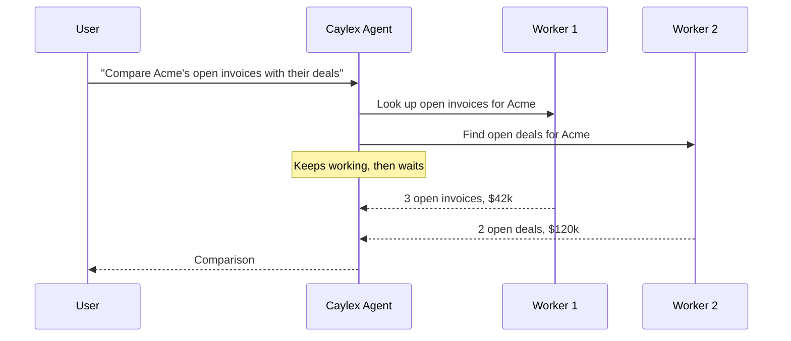

The Caylex agent can hand off parts of a request to **worker agents**. Each worker gets a focused task, works on it in its own context, and reports a summary back. The agent keeps working while its workers run, so independent pieces of work happen in parallel, and the agent's own context stays small.

You don't need to set anything up. Every agent has a built-in general-purpose worker, `general_subagent`. You can optionally:

- [Pick the model](#choosing-a-model) workers run on, for example a faster, cheaper model than the main agent.
- [Define your own workers](#defining-worker-agents) for recurring kinds of work, each with its own instructions, model and recommended tools.

## How It Works



- The agent starts workers in the background and continues with anything that doesn't depend on them.
- Each worker's result is added to the agent's conversation when it finishes. When the agent has nothing else to do, it waits and picks up each result as it comes in, instead of waiting for all of them.
- The agent's turn ends only after every worker it started has finished.
- If a result isn't good enough, the agent can send that worker a follow-up and it continues with its context intact.
- A turn can run up to 12 workers at once and start up to 30 in total.

### In the Chat Widget

Users see each worker as a card in the chat with its title and status. While workers run, a pill above the message box shows how many are working; it expands to list them, each with a **Stop** button, and has a **Stop All** button. When the agent is waiting on its workers, the chat shows "Waiting for N worker agents to finish...".

Clicking a worker opens its own chat, which streams live and is read-only. Its first message is the agent's instructions to it, labeled **Sent by parent agent**. A banner links back to the main chat.

Worker chats don't appear in the saved sessions list. They're reached from the chat that started them.

### Tool Approvals

Tool calls made by workers follow the same approval rules as the agent's own. When a worker needs an approval, only that worker pauses; the agent and the other workers keep going. The pill above the message box glows and reads **N pending actions need your approval**. Expanding it highlights the workers waiting on the user, and the worker's card in the chat shows **Needs your approval**. The approval card itself is in the worker's chat. If the agent has nothing else to do meanwhile, the chat shows **Waiting for your approval...**. If nobody answers, the request times out like any other and the agent is told.

## Choosing a Model

Pass `subassistant_model` (and optionally `subassistant_model_options`) on [`POST /widget/agent-session-init`](/widget/agent/model-selection#request), next to `model`:

```json
{
  "caylex_api_key": "ck_your_navigator_api_key",
  "user_email": "jane@example.com",
  "model": "anthropic/claude-opus-4.8",
  "subassistant_model": "openai/gpt-5.4-mini"
}
```

A worker runs on the first of these that's set:

1. Its definition's `model`, for a [worker you defined](#defining-worker-agents).
2. `subassistant_model`.
3. The session's `model`, when you chose one.
4. The worker's own default model.

Each chat keeps the worker model it was created with. A different `subassistant_model` in a later token applies to chats created after it.

## Defining Worker Agents

Pass a list of worker definitions as `subassistants` on session init (or on [`POST /agent-task`](/background-tasks/agent-tasks#submit-a-task)). The agent sees them as a menu next to `general_subagent`, and picks one by name when it starts a worker.

Many teams keep their definitions in a YAML file:

```yaml
subassistants:
  - name: invoice_researcher
    when_to_use: >
      Looking up invoices, payment status, or overdue balances.
      Not for creating or editing invoices.
    model: openai/gpt-5.4-mini
    system_prompt: |
      You look up invoices in QuickBooks. Always report amounts with currency,
      and list overdue invoices first.
    recommended_tools:
      - server_name: QuickBooks
        tool_name: invoices_list
    recommended_skills:
      - invoice-lookup
```

The API takes JSON, so load the file and pass the list:

<CodeGroup>
```python Python
import yaml

with open("subagents.yaml") as f:
    payload["subassistants"] = yaml.safe_load(f)["subassistants"]
```

```typescript TypeScript
import { readFileSync } from "node:fs";
import { load } from "js-yaml";

const { subassistants } = load(readFileSync("subagents.yaml", "utf8")) as { subassistants: unknown[] };
body.subassistants = subassistants;
```
</CodeGroup>

| Field | Required | Description |
| --- | --- | --- |
| `name` | Yes | Letters, numbers, `_` and `-`, starting with a letter. Unique within the list; `general_subagent` is reserved. |
| `when_to_use` | Yes | What the agent reads to decide when to pick this worker. Say when to use it, and when not to. |
| `system_prompt` | Yes | Instructions for the worker's role. They're added to the worker's own system prompt, so they stay in force for its whole run. |
| `model` | No | Model id or model profile id. An unsupported model is dropped with a warning, and the worker falls back as described in [Choosing a Model](#choosing-a-model). |
| `recommended_tools` | No | Tools the worker will likely need, as `server_name` and `tool_name`. |
| `recommended_skills` | No | Skill ids, slugs or names the worker will likely need. |

You can define up to 20 workers. Invalid definitions fail the request with `422`. Problems that don't, such as an unsupported model, come back in `subassistant_warnings`.

### Recommended Tools and Skills

Recommended tools and skills are checked when a worker starts. The ones that exist are listed in the worker's instructions, so it can skip searching for them; the worker still reads each tool's details and each skill before using it. Ones that don't exist are left out. They're suggestions, not limits: a worker can still use any other tool the agent can.

When the agent starts one of your workers, it can recommend more tools and skills for that task; they're added to the definition's.

### When Definitions Apply

Session init happens before any chat exists, so Caylex holds the definitions until a chat is created, then copies them onto that chat. **Each chat keeps the definitions it was created with.** Reopened chats keep theirs, and new definitions from your backend apply to chats created afterwards. Send the same definitions every time you mint a token for a user, including on token refresh.

## Writing Good Definitions

- **Make `when_to_use` decisive.** The agent chooses from it alone. "Looking up invoices and payment status. Not for creating invoices." works better than "A billing assistant."
- **Keep roles distinct.** Overlapping workers make the agent's choice harder; say what each one is *not* for.
- **Put the how in `system_prompt`.** Formatting rules, which systems to use and what to report back belong there, not in `when_to_use`.
- **Use a smaller model for narrow lookups.** Focused workers often do well on a faster, cheaper model than the main agent.
