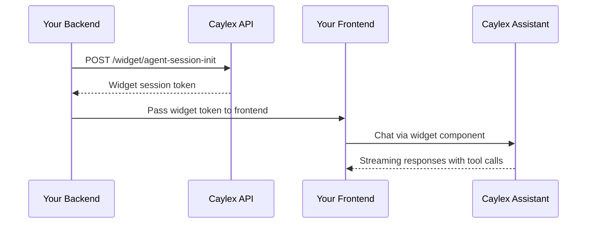

Caylex widgets let you embed AI agents directly inside your SaaS application. You can add an AI chat interface to run full agentic workflows, and optionally add a permissions panel that lets admin users manage which tools are enabled for the agent.

## Overview

Caylex provides two embeddable frontend components:

- **`<CaylexChatWidget />`** — a chat interface that connects to the Caylex Assistants API. It supports streaming responses, tool calls, saved sessions, connected-service visibility, a background-task approval Inbox, and optional agent-driven page navigation.
- **`<CaylexToolPermissionsWidget />`** — a permissions panel that lets end users control which tools are always allowed, require approval, or are disabled.

<CardGroup cols={2}>
  <Card title="Agent Widget" icon="messages" href="/widget/agent/embed">
    Embed the chat widget, manage sessions, push app context, and configure agent features.
  </Card>
  <Card title="Permissions Widget" icon="shield-check" href="/widget/permissions/embed">
    Let admin users control which tools the agent can use.
  </Card>
</CardGroup>

For native iOS apps, follow [Embed in iOS](/widget/agent/ios) to install the Swift package and render `CaylexChatView`. The iOS package uses the same chat UI and backend token flow.

Both widgets use **short-lived JWT tokens** minted by your backend. Your platform token and navigator API key stay server-side and never reach the browser.

## How Authentication Works

The widget uses a token-minting pattern:



<Steps>
  <Step title="Mint a widget token on your backend">
    Your backend calls the Caylex API with a platform access token, navigator API key, and user email.
  </Step>
  <Step title="Send the token to your frontend">
    Caylex returns a short-lived JWT that encodes the navigator context and user identity without exposing raw credentials.
  </Step>
  <Step title="Render the widget">
    Your frontend passes the token to the widget component. The widget handles session creation, streaming responses, token refresh, tool call display, and errors.
  </Step>
</Steps>

<Warning>
The mint endpoint must be called from your backend. Never expose your platform access token or navigator API key to the browser.
</Warning>

## Prerequisites

- A Caylex account
- A **Platform Token** from **Administration → Access Tokens**
- A **Navigator API Key** from your project's navigator drawer → **API Keys**
- A **User Email** for the end user who will chat with the assistant
- Node.js 18+ for your backend token endpoint
- React 18+ if you use the React component package

If your frontend does not use React, use the script-tag bundles instead. They include the widget's frontend dependencies and expose browser globals you can call from plain JavaScript.

## Install Packages

If your app uses React, install the widget packages:

```bash
npm install @caylex/chat-widget @caylex/permissions-widget
```

Install peer dependencies for the chat widget:

```bash
npm install antd @ant-design/cssinjs @ant-design/icons @emotion/cache @emotion/react @emotion/styled lodash.merge react-markdown remark-gfm
```

The permissions widget uses the same peer dependencies except `react-markdown` and `remark-gfm`.

The Caylex widget packages install the `@caylex/shared` package automatically.

For script-tag usage, you do not need to install NPM packages in your frontend. Load the hosted bundle from Caylex's asset CDN:

```html
<script src="https://assets.caylex.ai/widgets/chat-widget.js"></script>
<script src="https://assets.caylex.ai/widgets/permissions-widget.js"></script>
```

The unversioned URLs always serve the latest widgets. For production stability, you can pin a specific version:

```html
<script src="https://assets.caylex.ai/widgets/chat-widget@0.1.17.js"></script>
<script src="https://assets.caylex.ai/widgets/permissions-widget@0.1.4.js"></script>
```

<Warning>
The widgets isolate their Ant Design and Emotion styles from the host app by using a widget-specific Ant Design class prefix, injecting Ant Design css-in-js and Emotion styles into the widget root, and mounting widget popovers/drawers inside the widget container.

This prevents normal Ant Design theme/style collisions between your app and the widgets. It is not a full Shadow DOM or iframe boundary: extremely broad global CSS in the host app, such as `* { ... !important }`, `button { all: unset }`, or global `textarea` rules, can still affect embedded widget DOM. Avoid broad global selectors if you want the widget to render exactly as designed.
</Warning>

## Mint A Widget Token

Your backend mints a token by calling the Caylex API.

<Info>
This endpoint was previously named `POST /widget/mint-token`. It is now `POST /widget/agent-session-init`. The old path still works for backward compatibility, but we recommend using `/widget/agent-session-init` going forward.
</Info>

<Tabs>
  <Tab title="Python">
    ```python token.py
    import httpx

    CAYLEX_API_URL = "https://api.caylex.ai/api/v1/"
    PLATFORM_TOKEN = "your_platform_access_token"
    CAYLEX_API_KEY = "ck_your_navigator_api_key"

    async def mint_widget_token(user_email: str) -> str:
        async with httpx.AsyncClient() as client:
            response = await client.post(
                f"{CAYLEX_API_URL}widget/agent-session-init",
                headers={"Authorization": f"Bearer {PLATFORM_TOKEN}"},
                json={
                    "caylex_api_key": CAYLEX_API_KEY,
                    "user_email": user_email,
                },
            )
            response.raise_for_status()
            return response.json()["token"]
    ```
  </Tab>

  <Tab title="TypeScript">
    ```typescript token.ts
    const CAYLEX_API_URL = "https://api.caylex.ai/api/v1/";
    const PLATFORM_TOKEN = process.env.CAYLEX_PLATFORM_TOKEN!;
    const CAYLEX_API_KEY = process.env.CAYLEX_NAVIGATOR_API_KEY!;

    export async function mintWidgetToken(userEmail: string): Promise<string> {
      const response = await fetch(`${CAYLEX_API_URL}widget/agent-session-init`, {
        method: "POST",
        headers: {
          "Authorization": `Bearer ${PLATFORM_TOKEN}`,
          "Content-Type": "application/json",
        },
        body: JSON.stringify({
          caylex_api_key: CAYLEX_API_KEY,
          user_email: userEmail,
        }),
      });

      if (!response.ok) {
        throw new Error("Failed to mint Caylex widget token");
      }

      const data = await response.json();
      return data.token;
    }
    ```
  </Tab>
</Tabs>

The response includes:

- `token` — the widget JWT to pass to the frontend
- `expires_at` — ISO timestamp of when the token expires

## Token Refresh

Widget tokens are short-lived. To keep sessions alive without interruption, provide a `refreshToken` callback. The widget automatically calls this function when it receives a `401` response, obtains a fresh token, and retries the request.

<Tabs>
  <Tab title="React">

```tsx
<CaylexChatWidget
  // ...
  refreshToken={async () => {
    const res = await fetch('/api/caylex/token');
    const data = await res.json();
    return data.token;
  }}
/>
```

  </Tab>

  <Tab title="Script Tag">

```html
<script>
  async function fetchWidgetToken() {
    const res = await fetch('/api/caylex/token');
    const data = await res.json();
    return data.token;
  }

  async function mountCaylexChat() {
    const initialToken = await fetchWidgetToken();

    CaylexChat.render(document.getElementById('caylex-chat'), {
      // ...
      widgetToken: initialToken,
      refreshToken: fetchWidgetToken,
    });
  }
</script>
```

  </Tab>
</Tabs>

Your `/api/caylex/token` endpoint should call the Caylex mint endpoint from your backend and return the new token.

## Embedded AI

The Caylex platform includes an **Embedded AI** page where you can:

- Enter your credentials and mint tokens interactively
- Customize colors, dimensions, and feature toggles with live preview
- Test the chat widget with your actual servers and tools
- Switch between chat and permissions widget modes
- Download backend and frontend code snippets for React, script tags, Python, and TypeScript

Use the Embedded AI page to experiment with the widget before integrating it into your application.

## API Base URLs

The chat widget and permissions widget use different Caylex services:

| Widget | Base URL |
| --- | --- |
| Chat widget | `https://api.caylex.ai/api/v1/assistants/` |
| Permissions widget | `https://api.caylex.ai/api/v1/` |

## Updating Widgets

For React package usage, pull the latest widget versions with NPM:

```bash
npm update @caylex/chat-widget @caylex/permissions-widget
```

For script-tag usage, the unversioned CDN URLs automatically serve the latest deployed widgets:

```html
<script src="https://assets.caylex.ai/widgets/chat-widget.js"></script>
<script src="https://assets.caylex.ai/widgets/permissions-widget.js"></script>
```

If you want release stability, pin an explicit version and update the URL when you are ready to upgrade:

```html
<script src="https://assets.caylex.ai/widgets/chat-widget@0.1.17.js"></script>
<script src="https://assets.caylex.ai/widgets/permissions-widget@0.1.4.js"></script>
```

## Security Model

- **Platform token + navigator API key** stay on your backend
- **Widget JWT** is short-lived and contains only encoded navigator context and user email
- **No raw secrets in the browser** — the widgets communicate using the JWT
- **Playground keys are rejected** — the mint endpoint blocks playground API keys to prevent misuse

## Troubleshooting

| Issue | Cause | Fix |
| --- | --- | --- |
| "Failed to fetch widget token" | Backend not running or credentials invalid | Check your environment variables and ensure your backend endpoint is accessible |
| `CaylexChat is not defined` or `CaylexPermissions is not defined` | Script-tag bundle did not load | Check that the script URL is reachable, allowed by your Content Security Policy, and loaded before calling `render()` |
| CORS errors on permissions widget | Analytics API doesn't allow your origin | Use a backend proxy or register your domain with Caylex |
| Connected Services shows 0 | No MCP servers authenticated for the user | Ensure `user_email` matches a user who has connected servers in the Caylex project |
| Agent can't navigate pages | `navigablePages` is empty, the site map fetch failed, or `onNavigate` is missing | Ensure your backend site map endpoint returns pages and both navigation options are passed to the chat widget |
